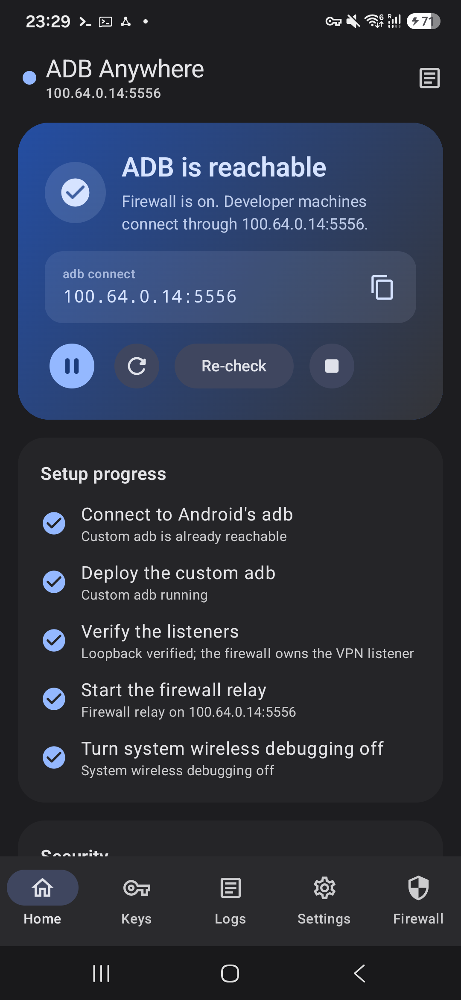
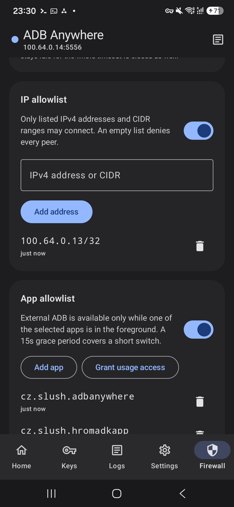
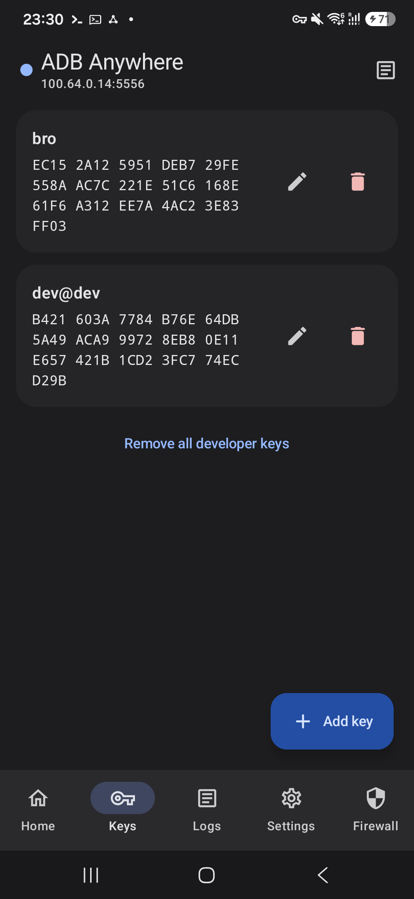

# adb-anywhere

Remote wireless ADB that follows your phone — over VPN, on mobile data, across
network changes. No root, stock Android 12+.

[](https://github.com/v1b3coder/adb-anywhere/actions/workflows/ci.yml)
[](https://github.com/v1b3coder/adb-anywhere/releases/latest)
[](LICENSE)

<p>
  
  
  
</p>

[Get it on Zapstore](https://zapstore.dev/apps/cz.slush.adbanywhere) · [signed APK](https://github.com/v1b3coder/adb-anywhere/releases/latest)

ADB Anywhere exists for one workflow: a real-time programming loop for small
Android utilities while traveling. The author runs T3 Code on the phone and keeps ADB
Anywhere in the loop, so the agent can write, deploy and test directly on the same
phone — no laptop, no USB cable and no root.

Android turns wireless debugging off when Wi-Fi disconnects, randomises its port
after reboot and exposes the stock listener on every interface. `adb-anywhere`
keeps a patched AOSP `adbd` running as the `shell` user with a loopback listener
for the app. By default, when a VPN is up, the daemon also listens on the VPN
address for your computers. With the optional firewall on, the app owns the VPN
address and the daemon stays loopback-only.

The app controls the daemon and decides which machines may connect. The daemon
process itself does not survive a reboot: the app redeploys it after boot once it can
reach Android's adb.

The design is in [docs/DESIGN.md](docs/DESIGN.md); the firewall and its limits are
in [docs/FIREWALL.md](docs/FIREWALL.md). Release notes are in
[CHANGELOG.md](CHANGELOG.md).

## Requirements

- Android 12 or newer, stock ROM, no root.
- A VPN that gives the phone a stable IPv4 address reachable by your computers
  (Tailscale or WireGuard). With the firewall on, the VPN must also include ADB
  Anywhere in the tunnel.
- One Wi-Fi connection for the first pairing.
- After a reboot the app needs one TCP shell to redeploy the daemon: Wi-Fi wireless
  debugging, the plain 5555 listener (`adb tcpip 5555` over USB), or root. The app does
  not keep ADB alive through the reboot by itself.
- The computer you connect from has its standard ADB public key at hand.
- Optional firewall: Usage access for the app allowlist, and Display over other apps
  for the floating approval card. Without overlay permission the prompt falls back
  to a notification and dialog.

## Install

Get it from [Zapstore](https://zapstore.dev/apps/cz.slush.adbanywhere), or download
the latest signed APK from the
[GitHub releases](https://github.com/v1b3coder/adb-anywhere/releases/latest) and
install it on the phone. Install a newer release over the current one; no uninstall
is needed. The release APK is `arm64-v8a`, which is what every Android 12 device
Google certifies runs. 0.x releases are previews.

The app needs `WRITE_SECURE_SETTINGS` for the ADB bootstrap. After the one-time
pairing it grants the permission over ADB. If an OEM blocks the grant, the app shows
the manual command instead of failing silently.

## First run

1. Open the app and allow notifications.
2. On a fresh install tap *Set up* in the status card; after a stop tap *Start*.
   Nothing starts the daemon before that.
3. Open Settings → Developer options → Wireless debugging → *Pair device with
   pairing code*.
4. Tap *Show pairing notification* in the app, pull down the shade and reply
   once with `code:port` (for example `123456:37123`). Opening the app closes
   Android's pairing dialog on AOSP, so the notification reply is the reliable
   path; there are no in-app manual fields.
5. The app pairs, grants `WRITE_SECURE_SETTINGS`, deploys the patched `adbd`,
   verifies loopback and either the VPN listener or the firewall relay, and turns
   Android's wireless debugging off last.
6. Add each computer's standard ADB public key under *Keys* (paste or QR). The
   screen shows the command for Linux and macOS, and the app shows the SHA-256
   fingerprint before the key is added.

After setup, connect from the computer:

```sh
adb connect <vpn-ip>:5556
```

The VPN port defaults to `5556`, one above the standard adb port `5555`; both ports
are configurable in Settings → Ports. The app's own channel defaults to
`127.0.0.1:15037` and is not reachable from the network.

## Start, pause and stop

The status card shows *Set up* on a fresh install, *Start* when stopped, and, while
running, *Pause* or *Resume* in firewall mode plus *Restart*, *Re-check* and *Stop*.
The app stores the last explicit choice in device-protected storage, so a stopped
app stays stopped when it is reopened, after a reboot and after the system restarts
the service, and a paused app stays paused. Only an explicit Start, Set up, Pair or
Restart starts it again, and none of them reopens a paused firewall.

In firewall mode *Pause* is the main action: it closes the VPN port and keeps the
custom adb running on loopback, so nothing on the network answers. *Resume* reopens
the VPN port against the same daemon and needs no new setup, which is why it also
works on mobile data. A *Stop* followed by a *Start* has to redeploy the daemon, and
that needs Android's adb once — the reason a Stop on mobile data cannot always be
undone there.

Auto pause lives in the Firewall tab: after the chosen time without an adb command,
the app takes the same Pause. The clock restarts with every real command from a
paired machine, so the app's own loopback channel and the watchdog never keep the
port open; a session that stays idle for the whole timeout is closed with the relay.

A fresh install waits for Set up or Start; an install that already completed setup
keeps its last choice across an update. Stop waits for a deployment in progress to
finish before it stops the daemon, and it reports the loopback port if the daemon is
still listening.

## Firewall

The optional firewall moves the VPN listener into the app. It is off by default.
When it is on, the daemon listens only on loopback and the app accepts the VPN
port, applies the IP and app allowlists and the call policy, then relays to the
daemon. ADB key authentication stays end-to-end.

*Pause* on Home closes the VPN port without stopping the daemon: the app keeps its
channel to the custom adb, nothing is reachable from the network, and *Resume*
reopens the port without a new setup. *Auto pause* in the Firewall tab does the same
after an idle timeout: no adb command for the chosen time (5 min to 12 h, or a
custom duration) closes the port on its own. Stopping the app instead tears the
daemon down, and starting it again may need Android's adb (Wi-Fi or USB).

The Firewall tab has:

- **Auto pause**: closes the VPN port after a chosen time without an adb command;
  the custom adb and the loopback channel stay up, and Resume brings the port back.
- **IP allowlist**: only listed IPv4 addresses and CIDR ranges may connect. IPv6
  is not supported.
- **App allowlist**: external ADB is available only while a selected app is in the
  foreground. A configurable grace period covers a short switch. Usage access is
  required.
- **Call policy**: rules for ADB service calls. An unmatched call asks for approval
  on the phone; the default is deny. The floating card offers Review and Block;
  Review opens the approval screen, where you can allow once, always allow that
  call, block it, or pin fields with a custom filter.
- **Audit log**: recent firewall decisions on the device and in the UI.

Each entry and rule shows when it last matched. The app's own loopback channel is
not filtered.

The firewall is policy and audit, not a sandbox: shell access and sync paths are
not isolated. The full design and its limits are in
[docs/FIREWALL.md](docs/FIREWALL.md).

## Security

- The daemon binds loopback and, by default, the VPN address. With the firewall
  on it binds only loopback and the app owns the VPN port. The daemon refuses to
  start if it cannot bind exactly those addresses.
- The loopback listener is TLS with a key the app generated and pins, and only
  the app's own key may connect to it. Other apps on the phone cannot use it or
  pose as the daemon.
- The app uses separate keys for Android's adb and for its own daemon, and signs
  an ADB login challenge only on a channel it has verified.
- The app's keys never leave the phone: they are excluded from backup and from
  device-to-device transfer.
- Only keys in the daemon key file are accepted. Unknown keys are never
  auto-accepted.
- Removing a key restarts the daemon and ends the sessions that key
  authenticated. It cannot undo what that machine already did as `shell`; if you
  suspect misuse, reboot and check the phone. Per-key policy is not implemented
  yet.
- The firewall does not add authentication. ADB key authentication stays
  end-to-end. Calls are allowed only in the approval screen, which hides other
  apps' overlays while it is shown.
- `adb reverse` ports are bound to the phone's loopback only.
- Only an explicit Start can re-enable Android's ADB, after the one-time
  permission grant; a reboot or the watchdog never does. Wireless debugging is
  re-enabled only for the Wi-Fi bootstrap. Stop leaves both alone unless you opt
  in.
- The app does not stop Android's ADB while it needs the daemon.
- If Android's ADB is reachable over the network anyway, the app warns you in the
  UI and in the notification.
- No root, no custom ROM, no fallback proxy and no random-port redirect.

## Limitations

- The daemon runs as the `shell` user, so it gives a shell, not root.
- The VPN listener needs a VPN address. Without a VPN the app still controls the
  daemon over loopback, but your computers cannot connect. With the firewall on,
  the VPN must include ADB Anywhere.
- The firewall IP allowlist is IPv4-only.
- The app allowlist needs Usage access. The floating approval card needs Display
  over other apps; without it the app uses a notification and dialog. A locked
  screen denies a call that needs approval. *Settings → Display → Keep the screen
  on* stops the display timeout from locking the phone while the app is open; it
  does not override the power button, and leaving the app releases it.
- A reboot does not keep the daemon running. The app redeploys it after boot when it
  can reach Android's adb; on mobile data without the plain 5555 listener it waits for
  Wi-Fi or USB. The app shows the recovery steps. A paused app comes back with the
  VPN port still closed, so nothing is exposed while it waits.
- On some OEMs Android does not restart wireless debugging on a Wi-Fi network
  without internet. Enable Wireless debugging once in Settings to recover.
- A VPN address change restarts the daemon when the firewall is off and rebinds the
  relay when it is on. Active sessions drop and must reconnect.
- The firewall relay runs in the app process. If Android kills it, external
  sessions drop until the service restarts.
- If an OEM blocks the permission grant, the app shows the manual command and stops.
- Updating from a version before the TLS loopback channel migrates the running
  daemon in place when Android's plain 5555 listener is closed; otherwise the app
  needs Android's adb once to redeploy it.
- Another app can keep the daemon from starting by holding its ports. The app
  reports the port; change the ports in Settings or reboot.

## Build

The Makefile owns every build, test and install command, and `make help` lists
them. `make check` is the gate CI runs: unit tests, lint and the debug APK. The
Gradle build compiles the vendored `adbd` for every ABI on `preBuild`, so a local
build needs the Android NDK; `ADBD_SKIP_BUILD=1` keeps the existing assets.

## License

The app's own code is MIT; see [LICENSE](LICENSE). The daemon bundled in `adbd/`
is derived from AOSP `adbd` and stays Apache 2.0; see [adbd/LICENSE](adbd/LICENSE).
Third-party attributions are in [NOTICE](NOTICE).
